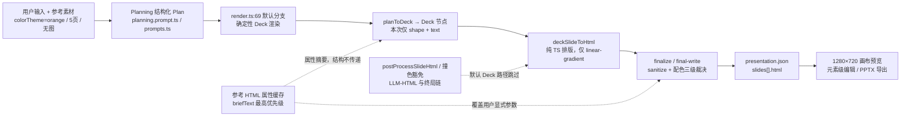
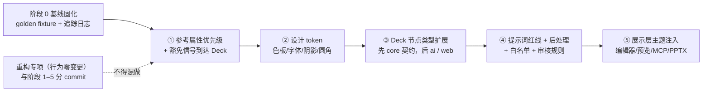

# NoPPT HTML 幻灯片视觉差距根因分析与 16:9 分页提质开发计划

> **文档状态**：分析交付稿。本轮只产出本文档，**未修改任何源码、配置或运行数据**。
> **生成日期**：2026-11-10
> **仓库根路径**：`d:/TraeSOLO/NoPPT`（下文所有路径均相对此根）
> **分析对象**：整个 NoPPT 仓库、`GoodSamplePPT/` 6 个 HTML 案例、最近一次生成产物 `packages/server/data/tenants/default/users/default/workspace/presentations/pres_mvxwps0f_xjm9ezs/`
> **文档规范**：遵循 `repo-wiki/README.md` 的纯 Markdown + Mermaid 约定；落 `repo-wiki/` 是因为 `.gitignore:55` 忽略 `docs/`、`:54` 忽略 `wiki/`、`:56` 忽略 `Slides_Templates/`、`:59` 忽略 `workflow-records/`，只有本目录可参与版本控制。

---

## 0. 结论摘要

差距不是「模型审美不行」，而是**当前生产链路在架构上就不产出复杂视觉**：LLM 只输出结构化 Plan，样式由纯 TS 的确定性 Deck 渲染器生成；该渲染器本次只用了 `shape` 与 `text` 两种节点、只支持 `linear-gradient`、不生成 `radial-gradient` / SVG 装饰 / 阴影 / CSS 变量，再叠加提示词单色红线与白名单约束，最终把「上传的 16:9 精美模板 + 用户配色」压成「白底 + 单一绿色 + 纯色几何块 + 大字标题」。

五条核心结论：

1. **【产物事实】** 本次 5 页共 49 个 Deck 节点，只有 `shape:22 / text:27` 两种 kind；全篇仅 7 种 6 位十六进制色值（其中 5 个是白/灰阶），`radial-gradient`、`box-shadow`、`<svg>`、`<table>`、CSS 变量均为 **0**。
2. **【代码事实】** `packages/ai/src/agents/html-presentation/stages/render.ts:66-71` 默认开启确定性 Deck 渲染；`deck/deck-to-html.ts:555-573` 支持 6 种节点、`:144-150` 只生成 `linear-gradient`、`:495` 的 SVG 只用于图表、`:644-649` 的 CSS 变量只消费不生成。
3. **【产物事实 + 代码事实（历史基线）】** 用户显式选「活力橙」（`colorTheme:"orange"`），产物却是 `#27AE60` 绿。旧链路的 `briefText` 曾写「绝对最高优先级 · 覆盖用户显式设置」，`final-write.ts` 旧裁决顺序为「分类参考主色 → deck 级参考主色 → 用户显式/默认蓝」。该色既不是用户橙预设 `#ea580c`，也不是参考主色 `#4c9a6b`，亦不在 `COLOR_THEMES` 六色枚举内（green 为 `#059669`）。**本轮已按用户纠正把优先级改为「用户配置 > 提示词颜色 > 模板色系」，并取消逐页分类参考色覆盖；历史换算环节不再复现。**
4. **【代码事实链】** 参考属性中 `isMultiColor=true`、`accents=2/2/4`，撞色豁免的触发条件已满足；但豁免文案只注入 LLM prompt 与 `postProcessSlideHtml` 链，而默认 Deck 路径按 `render-deck.ts:5-7` 明确「跳过 HTML 字符串手术与 postProcessSlideHtml 颜色/图表 pass」。即**豁免信号在生产渲染路径上没有消费端**——此为待复现的优先级问题，不写作已确认缺陷。
5. **【代码事实】** `GoodSamplePPT` 的视觉优势大部分**不需要新增框架或 CDN**：`packages/core/src/security/html-allowlist.ts:64-71` 已允许 `<svg>` 及其子元素，`:181/224/228/247/249` 已放行 `background-image` / `transform` / `box-shadow` / `backdrop-filter` / `filter`，`radial-gradient()` 值也未被 `web/src/utils/security.ts:83-108` 拦截。「渲染器不生成」不等于「安全白名单禁止」，这是最快可兑现的改善面。

**目标边界**：用户已确认按「**保持 16:9 分页提质**」推进——把样例的设计语言移植进现有 Deck 渲染器/主题系统，兼容元素级编辑、1280×720 缩放、预览、审核与 PPTX 结构化导出；**不引入长滚动讲义形态**。本文档首轮只分析不改代码；随后阶段 0–5 与「主题色优先级更正」已按用户确认落地。

---

## 1. 分析对象与方法

### 1.1 三份输入

| 输入 | 实际内容 | 用途 |
| --- | --- | --- |
| 「项目文件」 | `d:/TraeSOLO/NoPPT/项目文件` **目录不存在**（已用 `Get-ChildItem -Force` 与 `git ls-files` 双重核实）。按用户澄清，以**整个仓库**为对象：5 个包（`core / ai / server / web / audit`）、根目录项目文档、`repo-wiki/`、`Slides_Templates/HTML/` 50 个模板、`docs/`、`workflow-records/`、`corpus/` | 复核生成链路、既有诉求、导出与门禁约束 |
| `GoodSamplePPT/` | 6 个 HTML，74–136 KB / 1019–1831 行 | 提炼可移植设计语言与数值 |
| 最近产物 | `presentation.json`(60,213 B)、`ai-log.jsonl`(1,192,483 B)、`chat-history.json`(990 B)、`reference-attrs/e54a…json`(15,579 B)；目录内**无独立 .html 文件**，HTML 存于 `slides[].html` | 作为差距的被测样本 |

根目录项目文档已纳入：`AGENTS.md`（联调约定）、`AI生成演示全流程.txt`、`ToDoList.txt`、`未来计划.txt`、`HERMES_NOPPT_SOP.md` / `_SYSTEM.md` / `_USER_PROMPT.md`、`README_CN.md`、`workflow-records/complete-workflow-2026-10-07.md`、`docs/CODE_SCAN_REPORT.md`。

### 1.2 证据口径

全文用四类标记区分确定性，避免把推断写成缺陷：

- **【代码事实】**：可在指定行号读到源码。
- **【产物事实】**：可在 `presentation.json` / `ai-log.jsonl` / `reference-attrs` 中读到原文。
- **【推断】**：由上述事实推出的因果解释，尚未用运行时日志闭环。
- **【待复现】**：需要补日志或重放实验才能定论的问题。

### 1.3 载体差异（背景，不是缺陷）

6 个样例全部是**单文件自包含的长滚动讲义**：`<section id>` 分章 6–9 章、`max-width:1000~1120px`、无 16:9 固定画布、无 `transform:scale()`、无翻页脚本，靠锚点导航 + 阅读进度条 + 粘性毛玻璃顶栏组织阅读，且 6/6 带 `@media print`。NoPPT 是 1280×720 分页画布 + 元素级可编辑 + PPTX 导出。

因此「样例每节 300–800 中文字、产物每页 49–73 字」不能直接判为内容贫乏——投影页本就该精简。**真正可比的是：在同样的字数下，样例有统一的色板/字号/间距节奏、成体系的组件与手工图示，而产物几乎只有色块与文字。** 本文档后文只移植「设计语言」，不迁移载体。

> `ToDoList.txt:3-5` 记有「一般汇报场景不需要固定 16:9 的页面」「隔空连续滑动」的长期诉求，`未来计划.txt:13-18` 记有「模板库、组件片段、提示词库、偏好样本库」的经验回流主张；二者作为背景参考，本轮不纳入范围。

---

## 2. 差距量化对照

统计方式：对文件全文（产物为 `slides[].html`）做正则计数；各表「长度」列为 PowerShell 字符串**字符数**（非磁盘字节数，中文 UTF-8 占 3 字节）；「hex 唯一」按 3/6/8 位十六进制色值去重，「CSS变量」为 `--x:` 声明数，「字号层级」为 `font-size` 不同取值数。§2.1 末尾的「全篇色值分布」按 6 位色值单独统计，与表中数值口径略有差异。只读脚本复现方式见附录 C。

### 2.1 本次产物（5 页，1280×720）

| 页 | 页型 | HTML 字符数 | 中文字数 | hex 唯一 | CSS变量 | linear | radial | shadow | svg | table | 字号层级 | abs 定位 | 内容节点 |
| --- | --- | ---: | ---: | ---: | ---: | ---: | ---: | ---: | ---: | ---: | ---: | ---: | ---: |
| P1 封面 | `cover` | 3,611 | 56 | 5 | 0 | 1 | 0 | 0 | 0 | 0 | 4 | 8 | 4 |
| P2 判定 | `content-no-image` | 2,767 | 51 | 4 | 0 | 0 | 0 | 0 | 0 | 0 | 5 | 2 | 2 |
| P3 成因 | `content-flowchart` | 5,470 | 73 | 4 | 0 | 0 | 0 | 0 | 0 | 0 | 6 | 15 | 6 |
| P4 影响 | `content-cards` | 4,084 | 64 | 6 | 0 | 0 | 0 | 0 | 0 | 0 | 5 | 9 | 5 |
| P5 行动 | `summary` | 3,371 | 49 | 4 | 0 | 0 | 0 | 0 | 0 | 0 | 4 | 5 | 4 |
| **合计 / 全篇** | — | **19,303** | **293** | **7** | **0** | **1** | **0** | **0** | **0** | **0** | **≤6** | **39** | **21** |

【产物事实】`ai-log.jsonl` 的 `finalize-deck` 事件：`{"slideCount":5,"deckedSlides":5,"totalNodes":49,"perSlideNodeCount":[8,12,15,9,5],"fallbackEmptyNodeSlides":0}`；按 `deck[].nodes[].kind` 分组只有 `shape:22` 与 `text:27`，无 `image / table / chart / group`。全篇色值分布：`#27AE60 ×19, #1F2937 ×14, #FFFFFF ×5, #E5E7EB ×4, #F9FAFB ×4, #6B7280 ×3, #208F4F ×1`。

产物 P1 原文片段（【产物事实】）：

```html
<div style="... padding: 0px; background-color: #fff; display: flex; ...">
  <div ... data-canonical-root="true" data-logical-width="1280" data-page-type="cover" ...>
    <div style="position: absolute; left: 840px; top: 0px; width: 440px; height: 440px;
                border-radius: 50%; ... background: rgba(39,174,96,0.19)"></div>
    <div style="position: absolute; left: 0px; top: 440px; width: 480px; height: 280px;
                ... background: rgba(39,174,96,0.09)"></div>
    <div style="position: absolute; left: 80px; top: 144px; width: 3px; height: 432px;
                ... background: #27AE60"></div>
    <h2 ...><span style="color: #27AE60; font-weight: 700; font-size: 74px">
      厄尔尼诺简介：海温异常牵动全球天气</span></h2>
    <span style="color: #27AE60; font-weight: 700; font-size: 32px">
      赤道中东太平洋海温异常偏暖</span>
```

P3 的「流程图」由 3 个 `192×120` 圆角矩形 + 2 个 `32×24` 实心小矩形（箭头）拼成，无连线、无 SVG、无编号徽章、无引言块。

另有一处值得单独核查的产物异常：内层 canonical root 的 `style` 中出现 `font-family: -apple-system,BlinkMacSystemFont,\" data-canonical-root=\"true\"`，字体栈在引号处提前截断。【产物事实】+【待复现】：疑因 `deck/deck-to-html.ts:83` 的 `FONT_STACKS.sans` 含双引号字体名（`"Segoe UI"` / `"PingFang SC"`）却未做 HTML 属性转义，需重放确认；同时外层 div 另有一套 `system-ui,-apple-system,'Segoe UI',…` 字体栈，两处不一致。

### 2.2 GoodSamplePPT（6 个案例）

| 文件 | 字符数 | 中文字 | hex 唯一 | CSS变量 | linear | radial | shadow | svg | section | table | h1–h4 | @media | 字号层级 | 字体栈 |
| --- | ---: | ---: | ---: | ---: | ---: | ---: | ---: | ---: | ---: | ---: | ---: | ---: | ---: | ---: |
| `AI基础培训.html` | 100,771 | 8,022 | 95 | 14 | 3 | 3 | 15 | 49 | 6 | 1 | 90 | 2 | 25 | 1 |
| `AI生成幻灯片培训教程_V1.html` | 92,383 | 14,478 | 48 | 26 | 25 | 2 | 23 | 0 | 9 | 10 | 55 | 3 | 30 | 5 |
| `P-NP-ETH-科普培训.html` | 65,345 | 4,666 | 48 | 24 | 3 | 3 | 9 | 36 | 9 | 4 | 26 | 5 | 24 | 4 |
| `大模型核心技术原理整合_20261007.html` | 57,918 | 4,855 | 61 | 0 | 0 | 0 | 3 | 6 | 0 | 5 | 14 | 2 | 10 | 2 |
| `装调所AI知识培训_装调+AI_V1.html` | 99,625 | 17,402 | 52 | 28 | 17 | 2 | 19 | 1 | 8 | 14 | 45 | 13 | 24 | 5 |
| `设备动力部AI知识培训_动力+AI_V1.html` | 85,325 | 14,924 | 52 | 27 | 14 | 2 | 12 | 1 | 8 | 12 | 42 | 8 | 19 | 5 |

共同特征（【代码事实】，均为样例源码）：

- **变量级设计系统**：`设备动力部AI知识培训_动力+AI_V1.html:56-65` 定义 `--blue:#2563eb / --teal:#0d9488 / --amber:#d97706 / --rose:#e11d48 / --violet:#7c3aed` 及各色 soft 底、三级阴影、`--r:14px`；`AI基础培训.html:9-12` 为米黄 `#fbf7f0` + 糖果色；`P-NP-ETH-科普培训.html:11-19` 为纸蓝 `#F4F7FB` + 天蓝/珊瑚/日黄/薄荷/紫。
- **封面光效**：`设备动力部…:79-84` 用 `linear-gradient(170deg,#ffffff,#f3f7ff,#eef7f6)` + 2 个 560–620px `radial-gradient` 光斑 + `-webkit-background-clip:text` 渐变字；`P-NP-ETH…:88-93` 用三层 radial 光晕 + 荧光笔式标题高亮。
- **字体双栈与流体字号**：正文 `Noto Sans SC / PingFang SC / Microsoft YaHei`，标题 `Noto Serif SC / Songti SC / SimSun, serif` 且 `font-weight:900`；`clamp(30px,4.6vw,50px)` 封面、`clamp(24px,3vw,33px)` 章标题，正文 `15–16.5px / line-height:1.75–1.85`。
- **组件库**：KPI 数字卡（26px 衬线数字 + 顶部 3px 彩条）、学习地图/时间轴（2px 渐变竖线 + 12px 圆点）、纯 CSS 横向条形图、四色 callout、`💡` takeaway 金句块、5 级色阶热力表、决策矩阵、编号徽章 + 每章 1–2 句引言。
- **视觉资产**：无外链图片、无 base64 位图、无图标字体；主力是内联 SVG（49 / 36 / 6 处）与 CSS 绘图；CDN 仅 2 类——Noto 字体异步加载（`media="print" onload="this.media='all'"` + `<noscript>` 兜底）与 html2canvas；**无 Chart.js / ECharts / Tailwind / Font Awesome**。
- **动效克制**：无 `@keyframes`，只用 `transition:.15~.25s` 与 scroll 驱动进度条（`{passive:true}`）；6/6 有 `@media print`。

### 2.3 本次上传的参考模板（证明「输入并不贫瘠」）

【产物事实】`ai-log.jsonl` 记录 `referenceHtmlCoverLength:5646 / ContentLength:3403 / SummaryLength:4926`，`refAttrsVersion:e54a2848…` 被 4 次 `cacheHit:true` 复用；参考源可定位到 `Slides_Templates/HTML/` 的 nature 系列（`search_content` 命中 `HEALTH · NATURE` 与 `class="sun|wave|leaf"`）：

| 模板 | 字符数 | hex 唯一 | CSS变量 | linear | radial | shadow | svg | 字号层级 |
| --- | ---: | ---: | ---: | ---: | ---: | ---: | ---: | ---: |
| `cover/slide-cover-09-nature-fresh.html` | 5,646 | 14 | 7 | 2 | 1 | 3 | 4 | 3 |
| `content/slide-content-15-org-chart.html` | 3,662 | 11 | 4 | 0 | 0 | 1 | 0 | 7 |
| `back/slide-end-07-nature-thanks.html` | 5,374 | 14 | 7 | 2 | 1 | 3 | 4 | 3 |

`slide-cover-09-nature-fresh.html:15-23` 定义 7 个 CSS 变量；`:40-45` 的 `.slide` 背景是 `radial-gradient(600px 420px at 88% 14%, …)` 叠 `linear-gradient(155deg, …)`；`:49-88` 有 `.sun` 光晕、`.cloud` 多重阴影云朵、`.wave` 与 `.leaf` SVG 装饰。**这些在产物中一项都没有保留**——产物 P1 只有 2 个半透明圆/矩形色块和 1 根竖条。

> 表中「字符数」为模板文件全文；日志里的 `5646 / 3403 / 4926` 是清洗后注入参考通道的长度，与全文长度不等属正常（三文件磁盘字节数分别为 6049 / 3877 / 5579）。

### 2.4 差距比值

| 维度 | 样例（6 文件区间） | 本次产物（5 页） | 量级差 |
| --- | --- | --- | --- |
| 色值丰富度 | 48–95 种 / 文件 | 7 种 / 全篇 | 约 7–14 倍 |
| CSS 变量 | 0–28 个 / 文件（5/6 文件为 14–28） | 0 | 从有到无 |
| 径向渐变 | 0–3 处 / 文件 | 0 | 从有到无 |
| 阴影 | 3–23 处 / 文件 | 0 | 从有到无 |
| 内联 SVG | 0–49 处 / 文件 | 0 | 从有到无 |
| 字号层级 | 10–30 级 | 4–6 级 / 页 | 约 2–5 倍 |
| 组件/表格 | 1–14 张表 + 多类组件 | 0 张表、2 种节点 kind | 从有到无 |

> 注：样例为长卷讲义、产物为投影分页，绝对数值不可直接等同；可比的是「单位内容所获得的视觉组织手段」。

---

## 3. 现状生成链路



链路关键节点（均为【代码事实】）：

| 环节 | 位置 |
| --- | --- |
| 入口 | `packages/web/src/utils/api.ts:388-401` → `packages/server/src/modules/ai/ai.controller.ts:21-29` → `ai.service.ts:448,686-703` |
| 规划 | `packages/ai/src/agents/html-presentation/stages/planning.ts:55-79,291,395-502`；`prompts.ts:263-279,485-513` |
| 渲染分流 | `stages/render.ts:66-71`（`!== false` 即走 Deck）；字段定义 `packages/ai/src/types.ts:506-509` |
| 确定性渲染 | `stages/render-deck.ts:1-8`；`deck/deck-to-html.ts:2-18,82-92,144-178,280-301,393-495,555-573,644-649` |
| 后处理 | `palette.ts:68-165`（**17 步**，非 18）；`postprocess/layout.ts:79-86`；`html-sanitize.ts:331-339` |
| 落盘 | `packages/server/src/modules/ai/postprocess/final-write.ts:71-76,107-122,164-179` |
| 展示 | `packages/web/src/layouts/EditorLayout.tsx:1186-1207`；`packages/server/src/modules/mcp/deck-builder.ts:190-196,234-246` |
| 审核 | `packages/audit/src/engines/visual-engine/index.ts:266-270,370-375`；`packages/audit/src/engine/audit-engine.ts:263-264` |
| 导出 | `packages/web/src/export/presentation-to-deck.ts`；`export/pptx/deck-to-pptx.ts`；`export/pptx/shape.ts` |

---

## 4. 分层根因

### R1 · 载体形态差异（背景，非缺陷）

【代码事实】样例是 `<section>` 长滚动讲义，无 16:9 画布、无 `transform:scale()`；【产物事实】产物是 `data-logical-width="1280" data-logical-height="720"` 的绝对定位画布。样例的粘性导航、阅读进度条、`@media print`、章节锚点在分页编辑器里没有对应物。

**影响**：解释了「一眼看上去信息密度与排版气质不同」的一部分观感；但用户已明确不迁移形态，故不作为改造项，也不把样例的 100 KB 结构照搬进 `slides[].html`。

### R2 · 生成链路降维：LLM 不写样式，渲染器能力有限（主因）

【代码事实】`render.ts:66-71` 默认走 Deck；`deck/deck-to-html.ts:5-6` 明确「把『选版式 + 写内容』交给 LLM，把『排版 / 样式 / 合法性』交给纯 TS 代码」；`render-deck.ts:5-7` 说明该路径「跳过 HTML 字符串手术与 postProcessSlideHtml 颜色/图表 pass」。

渲染器能力边界（【代码事实】）：

- 节点 6 种（`deck-to-html.ts:555-573`：`text/shape/image/table/chart/group`）；本次实际只用 2 种（【产物事实】`shape:22 / text:27`）。
- `shape` 枚举在 `packages/core/src/deck/shapes.ts:10-60` 有约 40 种，但 HTML 渲染只区分 `ellipse` 与圆角矩形（`deck-to-html.ts:280-301`）。
- 渐变只有 `linear-gradient`（`fillToCss`，`:144-150`）；**无 `radial-gradient`**；有 `box-shadow`(`:169-178`) 但本次未产出。
- SVG 只用于图表 `line / pie|donut / bar`（`:393,:414,:447-448,:495`），**没有 SVG 装饰节点**。
- CSS 变量只消费不生成（`:644-649` 的 `var(--noppt-root-width,…)` / `var(--noppt-scale,…)`），无 `:root` 主题定义。
- 字体仅 3 族 `FONT_STACKS`（`:82-92`），且 `generate-html-presentation.ts:44-54` 另有 `getFontStackLocal()` 函数版双副本（`fontstack-dual-source-sync.test.ts` 逐字节比对，禁止合并）。

**影响**：即使 Plan 里写了「creative」「geometric-shapes」，渲染器也只能用「纯色块 + 文字」表达。这是「上传的模板有光晕/SVG/云朵，产物只有 3 个色块」的直接原因。

### R3 · 提示词红线把风格锁成单色白底

【代码事实】`packages/ai/src/templates/prompts/slide-html.prompt.ts`：

| 约束 | 行号 | 原文要点 |
| --- | --- | --- |
| 单色系红线 | `:145` | 「本页所有视觉元素只能使用 `{{PRIMARY_COLOR}}` / `{{PRIMARY_COLOR_DARKER}}` 及其透明度变体与中性灰阶」 |
| 禁跨色系渐变 | `:147` | 「严禁将主色与其他色系（橙色、绿色、紫色、红色等）混合做渐变」 |
| 白底/边框 | `:139` | 「边框：`#E5E7EB`；背景：`#FFFFFF`」 |
| 8px 网格 | `:14-21` | margin/padding/gap 必须是 8px 倍数，20/12/4/14/10 均非法 |
| 正文字号唯一表 | `:64` | 仅 19/18/20px，其他字号「会被审核 fatal 并强制返工」 |
| 禁手写字体 | `:594` | 「禁止手写全局 font-family」 |
| 单文件内联 | `:12,:600-607` | 只输出一个 div；外层必须 `background-color:#fff`；禁 `position:absolute` 做主布局 |
| 图片 | `:622-628` | 只能 1 个 `https://NOPPT_IMAGE_PLACEHOLDER` 占位符；cover/toc/summary 禁 `` |

另 `planning.prompt.ts:70-83,85-199` 的页型枚举虽扩到 30+ 种，但 `generate-html-presentation.ts:254-333` 的 `getPageTemplatesByPageType` 把多数新页型映射回 `content-cards` / `content-no-image` 骨架，未知页型落到 `MINIMAL_TEMPLATE_KIT`（`:231-242`，单列 3 个 li）。

**影响**：设计语言在「输入侧」就被判为违规。样例的 5–7 色语义板、衬线标题、14px 圆角、20–26px 卡片 padding、`clamp()` 流体字号，按现行红线几乎全部不合法。

### R4 · 参考克隆只传「属性摘要」，豁免信号无消费端

【产物事实】`reference-attrs/e54a….json` 的 `byCategory.cover.briefText` 原文：

```text
【参考提取的属性·绝对最高优先级·覆盖用户显式设置】以上摘要中的色彩/字体/密度/图标/配图偏好/
风格/背景/母版元素/页面布局，如与下方用户显式参数冲突，一律以参考提取为准；
未提取的属性以下方用户显式设置为准。
  - 主色参考：#4c9a6b
  - 视觉特征：构图=left-aligned / 标题层级=poster / 装饰=geometric-shapes /
    背景调性=light / 卡片圆角=large / 图片调性=illustration
```

同一文件的 `referenceHtml` 字段保留了 `<div class="sun">`、`<svg class="wave">`、`<svg class="leaf">` 等完整结构，但产物 P1 一个都没有。

【代码事实链】：

1. `packages/ai/src/utils/reference-attribute-resolver.ts:424-443` 与 `packages/ai/src/utils/reference/color.ts:201-216` 定义撞色豁免，唯一触发条件为 `palette.isMultiColor === true && accents.length > 0`；文案明确「不计入单色系红线的违规」。
2. 【产物事实】本次 `byCategory` 三类均为 `isMultiColor=True`、`accents=2/2/4`，**触发条件满足**。
3. 豁免文案仅通过 `prompts.ts:504` / `:801` 注入 LLM prompt 占位符（`planning.prompt.ts:432`、`slide-html.prompt.ts:49`），并由 `palette.ts:105-107` 的 `postProcessSlideHtml` 分支跳过 `sanitizeGradientColors` + `enforceSinglePalette`。
4. 而 `render-deck.ts:5-7` 的默认 Deck 路径跳过该 postProcess 链；`deck-to-html.ts` 本身不读取参考调色板生成多色/渐变/SVG。
5. `final-write.ts:164-179` 的终局重放还受 `exceedsThreshold(proofOfViolation)` 门控。

【推断 / 待复现】豁免机制「在纸面上生效、在生产渲染链路上没有被消费」，需要补一条「豁免信号是否到达 `deckSlideToHtml`」的追踪日志并重放确认。现有 `packages/ai/src/agents/reference-multicolor-fidelity.test.ts:61-69,84-98,164-175` 已断言多色板不被粉化、`allowedAccentHexes` 使 `colorViolations===0`，说明**豁免逻辑本身有测试守护，缺口在其与 Deck 路径的衔接**。

### R5 · 配色裁决优先级与 6 色枚举

【产物事实】`chat-history.json` 用户请求「配色：活力橙」；`ai-log.jsonl` 的 `plan` / `generate-presentation` 请求为 `"colorTheme":"orange"`；产物主色 `#27AE60`。

【代码事实】

- `packages/ai/src/agents/html-presentation/color.ts:151-162` 仅 6 色预设：`blue:#2563eb / purple:#7c3aed / green:#059669 / orange:#ea580c / teal:#0891b2 / gray:#4b5563`（`types.ts:132` 的 `ColorTheme` 同集合）。
- 旧 `final-write.ts` 注释「终局逐页取色三级链：分类参考主色 → deck 级参考主色 → finalEffectivePrimary」已被替换；现由 `resolveFinalEffectivePrimary` 生成 `generationOptions.deckPrimaryResolution`，终局写盘只消费该 deck 级结果。
- `packages/ai/src/utils/reference/color.ts` 的 `resolveFinalPagePrimaryColor` 已改为「封面模板色系 → global 模板色系 → fallback」；`color-priority.ts` 提供「用户配置 > 提示词颜色 > 模板色系」单一真源。
- `final-write.ts` 的 `simpleLog('AI:FINAL')` 现记录 `source / colorTheme / topicHint / templateTheme / referenceOverridden`；`allowedAccentHexes` 按最终主色派生的 visualTheme 动态注入。
- `final-write.ts:84-101` 有「参考属性未带上时回源重解析，否则回落默认蓝」的兜底。

【历史推断 / 已关闭】旧链路很可能走了三级链的前两级（参考主色），但 `#27AE60` 与参考 `#4c9a6b`、用户橙 `#ea580c`、预设绿 `#059669` 都不相等，中间存在未记录的换算环节。`ai-log.jsonl` 仅 10 条事件，旧版本没有终局取色明细。本轮已补 `AI:FINAL` 六态来源日志并按用户纠正反转优先级，Q1 不再作为待复现缺陷保留。

### R6 · 后处理与安全白名单的「反向纠偏」

【代码事实】

- `palette.ts:68-165` 的 `postProcessSlideHtml` 共 **17 步**（`sanitizeSlideHtml → sanitizeStyleSyntax → [豁免分支] → sanitizeGradientColors → enforceSinglePalette → enforceBodyFontSize → enforce8ptGrid → … → enforceSingleColumn → assertGrid8pt → injectStructuredGraphics`）。
- `postprocess/layout.ts:79-86` 剥离 `<script>` / `<style>` / `on*`，并强制 img `borderRadius:12px`；`html-sanitize.ts:331-339` 同样剥离。
- `constants.ts:13-19` 把正文钳在 16–20px；`html-sanitize.ts:122-155` 的 `enforceSingleColumn` 会把 `display:grid` 改成 `flex` 并强制 `flex-direction:column`。
- `packages/core/src/security/html-allowlist.ts:15-72` 的标签白名单**不含** `<style>/<script>/<link>`；`:147-278` 的 CSS 属性白名单**含** `background-image / box-shadow / transform / backdrop-filter / filter / background-clip / inset`；`:64-71` **允许 `<svg>` 及 `path/circle/rect/…`**。`web/src/utils/security.ts:83-119` 只拦 `javascript:` / `expression()` / `@import` / `behavior:` 与非白名单 `url()`，`radial-gradient()` 不被拦截；服务端同构副本在 `server/src/utils/sanitize.ts:73-78,105-108`。
- 审核：`visual-engine/index.ts:266-270` 用 `severity:'error'`（低对比度 <3.0 见 `:370-375`），`audit-engine.ts:263-264` 的 `regenerationRequired = errorCount > 0` 触发重生成；字面 `fatal` 在 `visual-engine/vlm-critique.ts:17,53` 与 `ai/src/templates/slide-critique.ts:80-84,419`。`vlm-critique.ts:93-96,289-296` 有「有参考时通用规范类 fatal 降级为 warn」的既有豁免。

**影响**：任何偏离红线的输出都会在写盘前被 `final-write.ts:71-76` 清洗、被 `finalGuard` 条件重放（`:164-179`）或被审核打回。**但要注意白名单并非视觉上限**——`radial-gradient`、`<svg>`、`box-shadow` 都已在允许范围内，缺口在渲染器（R2）与提示词（R3），不在安全层。

### R7 · 展示层不注入主题，舞台强制白底

【代码事实】

- `EditorLayout.tsx:1205` 是 `--noppt-scale` / `--noppt-root-width` / `--noppt-root-margin` 的唯一注入点，且 `--noppt-scale` 值固定为 `1`；`preview.tsx:90-107` 与 `PreviewPage.tsx:77-128` 用 `transform: scale()`，不注入主题变量。
- `deck-builder.ts` 舞台与页面背景已改为 `var(--noppt-stage-bg, ...)`，并由 `presentation.design.primaryColor` 派生主题变量；不再强制唯一白/蓝底（`body` 本身是深色 `#0F172A`，不可误述为整页白底）；`:190-196` 的 `fit()` 只做等比缩放。
- `deck-builder.ts:34` 有 `MAX_INLINE_BYTES = 20MB` 的 data URL 内联上限；`McpPreviewPage.tsx:9-11,139-144` 用 `iframe sandbox="allow-scripts"`。

**影响**：即使生成端产出多色主题，展示层也没有主题切换/注入机制，且白底会被再次覆盖。样例的深色结尾页、米黄纸底、渐变 hero 在这里无法存活。

---

## 5. 改善建议（按收益 / 风险 / 改动面排序）

### 5.1 分级清单

| 级别 | 建议 | 收益 | 风险 / 改动面 | 依据 |
| --- | --- | --- | --- | --- |
| **P0-1（已更正）** | 反转配色优先级为「用户配置主题色 > 提示词颜色 > 模板色系」，无前两者时全篇统一封面模板色系；补 `AI:FINAL` 六态来源日志并改写配置页文案 | 高（「选橙出绿」不再发生，封面/内容/结尾色系一致） | 中：`color-priority.ts`、`final-write.ts`、`render-deck.ts`、`ReferenceMaterialSection.tsx` 与回归测试 | R5 + 用户纠正 |
| **P0-2** | 让撞色豁免信号在确定性 Deck 路径可达：`deckSlideToHtml` 接收 `allowedAccentHexes` / 参考调色板，或提供等价的 Deck 级开关 | 高 | 低—中：`render-deck.ts`、`deck/deck-to-html.ts`、`planning.ts:137-139`、`generate-slide.ts:111-113` | R4 |
| **P0-3** | 修复 `FONT_STACKS` 写入 `style` 属性时的引号转义；统一外层/内层字体栈 | 中（消除破损属性） | 低：`deck/deck-to-html.ts:82-92` | §2.1 |
| **P0-4** | 补视觉密度追踪日志与 characterization 测试，把本次产物固化为 golden fixture | 中（后续改造可度量） | 低：仅新增测试与日志 | §6 阶段 0 |
| **P1-1** | 设计 token 常量化：语义色板（5–7 主色 + soft 底）、三级阴影、圆角、间距节奏、字号层级、字体双栈 | 高 | 中：新增 `deck/visual-tokens.ts`；`deck-to-html.ts`、`generate-html-presentation.ts:44-54`、提示词占位符；**不得合并 `getFontStackLocal`/`getFontStack` 双副本** | R2/R3/§5.2 |
| **P1-2** | 渲染器增量能力：`radial-gradient` 光晕、多层渐变背景、`box-shadow`、SVG 装饰路径、渐变文字、卡片顶部彩条 | 高 | 中：`deck-to-html.ts:144-178`；白名单已放行，无需改安全层 | R6 |
| **P1-3** | 提示词红线参数化：单色红线 → 受控语义色板；8px 网格/字号唯一表 → token 驱动；允许衬线标题 | 高 | 中：`slide-html.prompt.ts`、`planning.prompt.ts`、`palette.ts`、审核评分规则**必须同步** | R3/R6 |
| **P2-1** | Deck 节点/版式组件扩展：编号徽章章节头、KPI 数字卡、时间轴连线、引言块、四色 callout、热力表、金句页 | 高 | 高：先改 `packages/core/src/deck/{schema.ts,shapes.ts}` 共享契约，再改 `plan-to-deck.ts` / `deck-to-html.ts` / `layout-templates.ts` / 页型映射 / PPTX shape 映射 | R2/§6.3 |
| **P2-2** | 参考克隆从「属性摘要」升级为「结构片段白名单」：允许把模板中的 `<svg>` 装饰、渐变层、卡片骨架转成 Deck 节点 | 高 | 高：`utils/reference-attribute-resolver.ts`、`reference/color.ts`、`server/modules/ai/reference/`；受 2MB 参考 HTML 上限约束 | R4 |
| **P3-1** | 展示层主题注入：编辑器/预览/MCP 舞台按主题背景渲染，取消 `.slide` 硬编码白底 | 中 | 中—高：`EditorLayout.tsx`、`preview.tsx`、`PreviewPage.tsx`、`deck-builder.ts:234-246`、`web/src/export/` | R7 |
| **P3-2** | 审核与回归规则同步：合法语义色不判 error、对比度底线保持、PPTX parity 映射扩展 | 中（不做的会打回 P1/P2 成果） | 高：跨 `packages/audit` / `packages/web` / `packages/server` | R6 |

### 5.2 从样例提炼、可直接写进 token 的设计规范

以下数值来自 §2.2 的代码事实，建议作为 `visual-tokens.ts` 的初始值（**不必照搬长卷结构**）：

1. 语义色板：主蓝 `#2563eb`、青 `#0d9488`、琥珀 `#d97706`、玫红 `#e11d48`、紫 `#7c3aed`，各配 soft 底 `#eff6ff / #f0fdfa / #fffbeb / #fff1f2 / #f5f3ff`；底色 `#f5f7fb` 或 `#fbf7f0`；正文 `#0f172a` / `#475569` / `#94a3b8`；边框 `#e3e8ef`。
2. 语义固定：蓝=信息、青/绿=正确与优点、琥珀=提醒、玫红=风险。
3. 字体双栈：正文无衬线 `Noto Sans SC / PingFang SC / Microsoft YaHei / system-ui`；标题衬线 `Noto Serif SC / Songti SC / SimSun, serif`，`font-weight:900`。
4. 字号层级（16:9 需等比放大后再审）：封面 `clamp(30px,4.6vw,50px)`、章标题 `clamp(24px,3vw,33px)`、KPI 数字 26px、卡标题 15–16px、标签 11–12.5px；层级级差 ≥2px。
5. 圆角 10/12/14/16/18/20/24px + 胶囊 `999px`；边框统一 `1px solid var(--border)`。
6. 三级阴影 `0 1px 3px rgba(15,23,42,.06)` / `0 4px 16px rgba(15,23,42,.06)` / `0 12px 32px rgba(15,23,42,.08)`。
7. 卡片节奏 `padding:20–26px`、`gap:14–18px`、`margin:14–18px 0`；网格 2/3/4 列。
8. 封面三件套：渐变底 + 2 个 560–620px `radial-gradient` 光斑 + `-webkit-background-clip:text` 渐变字。
9. 章节起手式：彩色编号徽章 + 标题 + `max-width:860px` 的 1–2 句引言 + 4px×18px 渐变竖条。
10. 图示优先内联 SVG / CSS 条形图，不引图表库；`svg{width:100%;height:auto;display:block}`。
11. 动效只用 `transition:.15~.25s` 与 hover `translateY(-2~-3px)`，**不加 `@keyframes` 入场动画**。
12. 对比度底线：正文对底 ≥4.5，低于 3.0 会被 `visual-engine/index.ts:370-375` 判 error 触发重生成。

### 5.3 明确不做

- **不做**长滚动讲义 / 单文件滚动网页输出（用户已确认保持 16:9 分页）。
- **不做**回退到「LLM 自由写整页 HTML」：会同时破坏元素级可编辑、1280×720 缩放、Deck→PPTX 结构化导出与视觉审核门禁四项基础能力（依据 `canonical-html-export.integration.test.ts`、`presentation-to-deck.integrity.integration.test.ts`）。
- **不引入** CDN / Tailwind / ECharts / 外部字体服务：`slide-html.prompt.ts:12,600-607` 要求单文件内联，`html-allowlist.ts` 不含 `<link>/<style>`；样例本身也只用自包含 SVG + CSS。
- **不把**样例 60–140 KB 的整页 HTML 直接塞进 `slides[].html`：受 `deck-builder.ts:34` 20MB 内联上限、元素级编辑与 PPTX parity 共同约束。
- **本轮不改代码**：以上均为下一轮独立计划的候选内容。

---

## 6. 分阶段开发计划（保持 16:9 分页）

### 6.0 顺序判定：哪些阶段先动共享契约，哪些可先动提示词

- **可先动提示词/常量的阶段**（阶段 1、2）：只涉及 `packages/ai` 内部实现与 `packages/server` 的裁决逻辑，不改公开导出集合，也不改 `packages/core`。
- **必须先动共享契约的阶段**（阶段 3）：新增 Deck 节点 kind / shape 必须先改 `packages/core/src/deck/{schema.ts,shapes.ts}` 并从 `packages/core/src/deck/index.ts:12-16` 导出，再改 `packages/ai` 的 `plan-to-deck.ts` / `deck-to-html.ts` 与 `packages/web/src/export/pptx/shape.ts`。
  - 依据：`references/export-redlines.md:49-51` 记录 `packages/server/tsconfig.json` 指向 `../core/dist` / `../ai/dist`，**改 ai 包结构后须先 `pnpm --filter @noppt/ai build` 再 `pnpm --filter @noppt/server typecheck`**，否则用旧产物假通过。
  - 依据：`presentation-to-deck.integrity.integration.test.ts:57,74-85` 断言「Deck 优先于矛盾 HTML」「parity 不符时 `buildPptx(deck)` 抛 `integrity requires review`」，新 kind 未同步映射会直接卡住导出。
- **视觉改造与重构解耦**：`noppt-refactor` 的核心原则是「行为零变更、禁止顺手改业务逻辑」，而本计划阶段 1–5 是**刻意的行为变更**。二者必须分属不同阶段 / 不同 commit；不要在做视觉改造时顺手拆分巨型文件，重构专项单独排期（§6.4）。

### 6.1 阶段 0 · 证据与基线固化（无行为变更）

| 项 | 内容 |
| --- | --- |
| 目标 | 把本次产物固化为可回归的视觉密度基线；补齐目前缺失的追踪日志口径 |
| 涉及文件 | 新增 `packages/ai/src/agents/html-presentation/deck/__tests__/visual-density.test.ts`（或同类）；`final-write.ts:107-150` 补裁决日志；`planning.ts:137-139` / `render-deck.ts` 补豁免信号日志；本 `repo-wiki/` 文档 |
| 验收标准 | 测试可复现本次「7 色 / 2 种 kind / 0 radial / 0 svg / 0 shadow」基线；`colorTheme=orange` 重放时日志能回答「谁覆盖了谁、最终主色从哪来」；`pnpm verify` 全绿 |
| 回归风险 | 基线断言若写成「目标值锁定」，后续改造会被自己的测试挡住；快照须可显式更新，并把「现状值」与「目标值」分开 |

### 6.2 阶段 1 · 参数优先级与豁免信号打通（P0，收益最高）

| 项 | 内容 |
| --- | --- |
| 目标 | 消除「选橙出绿」的静默覆盖；让参考调色板/accents 能到达 Deck 渲染器 |
| 涉及文件 | `packages/ai/src/utils/reference/color.ts:153-162,201-216`；`utils/reference-attribute-resolver.ts:424-443`；`server/src/modules/ai/postprocess/final-write.ts:107-179`；`agents/html-presentation/stages/{render-deck.ts,generate-slide.ts,planning.ts}`；`prompts.ts:504,801`；`web/src/components/ai-generate/ReferenceMaterialSection.tsx` |
| 验收标准 | 同一请求重放：用户显式主色生效，或 UI/日志明确说明覆盖来源；`isMultiColor=true` 时 accents 进入 `deckSlideToHtml`；`reference-multicolor-fidelity.test.ts` 与新增用例全绿 |
| 回归风险 | `export-surface.test.ts:22-30` 锁定 5 个红线符号，新增导出需走 barrel 并同步 `repo-wiki/packages/ai.md`；参考属性缓存 `refAttrsVersion` 需版本化失效；PPTX 主题色需与 HTML 一致 |

### 6.3 阶段 2 · 设计 token 与渲染器增量能力（P1）

| 项 | 内容 |
| --- | --- |
| 目标 | 落地 §5.2 的 token；渲染器支持 `radial-gradient` / 多层背景 / `box-shadow` / SVG 装饰 / 渐变文字 |
| 涉及文件 | 新增 `packages/ai/src/agents/html-presentation/deck/visual-tokens.ts`；`deck/deck-to-html.ts:82-92,144-178,280-301,644-649`；`templates/generate-html-presentation.ts:44-54,231-333`；`templates/prompts/slide-html.prompt.ts:14-21,64,139-150,417-426,589-607`；`templates/structured-graphics.ts` |
| 验收标准 | 同一 Plan 可切换 ≥3 套色板且视觉差异可截图对比；新增 token 单测；`fontstack-dual-source-sync.test.ts`、`postprocess-fontfamily-passthrough.test.ts` 仍通过；1280×720 无溢出 |
| 回归风险 | 新增文件不得触发 `gates:check`（`max-lines` 800 / `max-lines-per-function` 200 / `max-params` 5）；字体双副本**禁止合并**；提示词放宽后审核评分规则尚未同步，需与阶段 4 联动灰度 |

### 6.4 阶段 3 · Deck 节点与版式组件扩展（P2，先 core 后 ai/web）

| 项 | 内容 |
| --- | --- |
| 目标 | 新增徽章章节头、KPI 数字卡、时间轴连线、引言块、四色 callout、热力表、金句页；把参考模板的 SVG 装饰转成合法 Deck 节点 |
| 涉及文件 | **先改** `packages/core/src/deck/{schema.ts,shapes.ts,index.ts}`；再改 `packages/ai/src/agents/html-presentation/deck/{plan-to-deck.ts,layout-templates.ts,slide-contract.ts,deck-to-html.ts}`、`templates/prompts/planning.prompt.ts:70-199`、`templates/generate-html-presentation.ts:254-333`；最后 `packages/web/src/export/pptx/{shape.ts,deck-to-pptx.ts}` 与 `server/src/modules/ai/reference/` |
| 验收标准 | 每页节点 kind 从 2 种提升到 ≥4 种、色值数 ≥15、出现 ≥1 处 SVG 装饰或 radial 光晕；`canonical-html-export.integration.test.ts:27-38`（`data-content-id` / `data-deck-node-id` / `data-role` / `data-canonical-root`）、`presentation-visual-integrity.preservation.test.ts:120-136`、`presentation-to-deck.integrity.integration.test.ts` 全绿；编辑器元素仍可选中 |
| 回归风险 | PPTX parity 会因未映射的新 kind 抛错；`html-allowlist.ts` 允许 `<svg>` 但不允许 `<style>`，所有样式必须内联；`enforceSingleColumn` 会重写 `display:grid`，组件布局需与阶段 4 同步 |

### 6.5 阶段 4 · 提示词 / 后处理 / 审核规则同步（P1-3 + P3-2）

| 项 | 内容 |
| --- | --- |
| 目标 | 单色红线 → 受控语义色板；8px 网格与字号唯一表 → token 驱动；后处理与终局重放不再抹掉合法新样式；审核不误判 |
| 涉及文件 | `slide-html.prompt.ts`；`palette.ts:68-165`；`postprocess/layout.ts:79-155`；`html-sanitize.ts:331-339`；`constants.ts:13-19`；`final-write.ts:71-179`；`packages/audit/src/engines/visual-engine/{index.ts,vlm-critique.ts}`；`ai/src/templates/slide-critique.ts:80-84,419`；`web/src/utils/security.ts` 与 `server/src/utils/sanitize.ts` 同构副本 |
| 验收标准 | 新增「多色主题不被 `enforceSinglePalette` 重写」用例；`postprocess-fontfamily-passthrough.test.ts` 全绿；audit 对合法语义色不判 error，WCAG <3.0 仍拦截 |
| 回归风险 | `final-write.ts:164-179` 的条件重放会二次抹色；前后端 sanitize 双副本必须同步；审核放宽后可能放过真实溢出/低对比问题，需保留 L0 无障碍底线 |

### 6.6 阶段 5 · 展示层主题注入与全链路回归（P3）

| 项 | 内容 |
| --- | --- |
| 目标 | 编辑器/预览/MCP 舞台按主题渲染；取消 `.slide` 硬编码白底；预览、编辑、PPTX 视觉一致 |
| 涉及文件 | `web/src/layouts/EditorLayout.tsx:1180-1207`；`web/src/components/ai-generate/preview.tsx:90-107`；`web/src/pages/PreviewPage.tsx:77-128`；`server/src/modules/mcp/deck-builder.ts:190-246`；`web/src/export/`；`packages/audit/` |
| 验收标准 | 3 套主题在编辑器、预览页、MCP iframe 预览、PPTX 导出四端视觉一致；`presentation-to-deck.integrity.integration.test.ts` 全绿；iframe `sandbox="allow-scripts"` 约束不变；`pnpm verify` 全绿 |
| 回归风险 | 主题背景与 `low-contrast` 规则冲突；`@media print` 不适用于 16:9 舞台，不要照搬样例；`deck-builder.ts:34` 的 20MB 内联上限不得绕过 |

### 6.7 五个改造切面（依赖顺序）



### 6.8 重构专项：拆分顺序、导出红线、测试门禁、禁止事项

以下四项来自项目级 Skill `noppt-refactor`（`.codebuddy/skills/noppt-refactor/`）及其 `references/export-redlines.md` / `references/split-map.md`，**凡后续阶段触及巨型文件必须逐条核对**。

#### (1) 拆分顺序（风险从低到高）

| 序 | 目标 | 风险 | 与本计划的关系 |
| --- | --- | --- | --- |
| 1 | `templates/generate-html-presentation.ts` | 极低 | 阶段 2 的模板工厂改动落此；已是 298 行，纯常量/模板工厂 |
| 2 | `server/.../ai.service.ts` 纯工具方法 | 低 | 阶段 1 若需动 service 工具层 |
| 3 | `agents/html-presentation-agent.ts` 顶层工具层 | 中 | 阶段 2 若外置 token 常量 |
| 4 | `ai.service.ts` 的 post-process / reference / edit 块 | 中 | 阶段 1、4 的裁决与清洗逻辑 |
| 5 | React 组件的 hooks 与 JSX | 中 | 阶段 5 的编辑器/预览注入 |
| 6 | `html-presentation-agent.ts` 的 class 方法 | **高** | 16 个测试直接依赖原型直调，无测试网禁止搬移 |

补充约束：`references/split-map.md:310` 记录「`render.ts` / `assemble.ts` 深度再切分已按用户决策终止、保持现状」；已建 `stages/__tests__/render-assemble.test.ts`（9 例）作为护栏，两文件均 <800 行不触发 `max-lines` 门禁。**本计划不重启该拆分**。

#### (2) 对外导出红线（零变更）

- `packages/ai/src/index.ts:10` 的 `export * from './agents'`；`:29-35` 的具名导出 `resolveEffectivePrimaryColor / resolveProposalPrimaryColor / COLOR_THEMES / darkenColor / assertHueClose`；`agents/index.ts:2` 的 `export * from './html-presentation-agent'` 必须继续解析到上述符号。
- `packages/server/build.mjs:24` 声明的 `@noppt/ai/agents/html-presentation-agent` 等 alias 要求**原路径文件必须存在**；验证 `pnpm --filter @noppt/server build`。
- `stages/index.ts` 的 **15 个再导出集合不变**；C 档函数首参仍为 `deps: AgentDeps`；`stages/` 内 0 处 `this.`。
- `getFontStackLocal`（`generate-html-presentation.ts:44-54`）必须物理留在原文件并保留「漂移回归守卫」注释：`fontstack-dual-source-sync.test.ts:36` 按源码路径逐字节比对，**禁止与 `getFontStack` 合并**。
- 原路径文件保留为 barrel（`export *` 只增不减），禁止删除/改名；`web/src/i18n/locales/*.ts` 不动；store 的 action 名与 selector 签名保留。
- 若阶段 2/3 新增对外导出，按 `repo-wiki/contributing/DOCS_WORKFLOW.md` 同步 `repo-wiki/packages/ai.md` / `packages/core.md`。

#### (3) 测试门禁

- 每一步先补**行为锁定测试**（characterization test），再动实现；无测试网不得搬移高风险 class 方法。
- 统一验收：`pnpm verify` = `pnpm typecheck` + `pnpm test` + `pnpm gates:check` + `pnpm deps:circular`，缺一不可。
- `gates:check` 阈值（`baseline/eslint-gates.json` 含 69 个存量违规文件）：`max-lines` 800 / `max-lines-per-function` 200 / `complexity` 40 / `max-depth` 5 / `max-params` 5；**新增文件自身不得产生违规**（`AIGenerateModal.tsx` 是既有豁免）。
- `deps:circular`：存量 4 处循环依赖，**新增必须为 0**；新模块单向依赖、不回指。
- 改 ai 包结构后先 `pnpm --filter @noppt/ai build`，再 `pnpm --filter @noppt/server typecheck`（server tsconfig 指向 dist）。
- 必须保持的既有回归网：`agents/__tests__/export-surface.test.ts`、`agents/reference-multicolor-fidelity.test.ts`、`agents/postprocess-fontfamily-passthrough.test.ts`、`fontstack-dual-source-sync.test.ts`、`stages/__tests__/render-deck-html.test.ts`、`stages/__tests__/render-assemble.test.ts`、`deck/__tests__/canonical-html-export.integration.test.ts`、`deck/__tests__/presentation-visual-integrity.preservation.test.ts`、`web/src/export/__tests__/presentation-to-deck.integrity.integration.test.ts`、`web/src/hooks/__tests__/element-utils.test.ts`。

#### (4) 禁止事项

1. 禁止删除原路径文件（必须保留为 barrel）；禁止在拆分中顺手改业务逻辑、重命名、调整格式或新增日志。
2. 禁止一次性搬移多个不相关区块；每个 commit 只搬一个逻辑块，`git diff --stat` 应呈现「新文件 +N 行 / 原文件 −N 行」。
3. 禁止合并 `getFontStack` / `getFontStackLocal` 双副本；禁止跳过 `pnpm verify`；禁止升级 ESLint 大版本或迁移 flat config。
4. 禁止把 `render.ts` / `assemble.ts` 整体搬成新文件：`gates:check` 会把 595 / 670 行的单函数判为「新增违规文件」（`split-map.md:283-290` 有实测回滚记录）。
5. React 粗粒度下沉，保留 `useState` / `useEffect` 原样，子组件只接 value + setter/回调。
6. **本计划特别约束**：阶段 1–5 是行为变更，不得与「行为零变更」的重构混在同一 commit；重构专项须单独排期。

### 6.9 回归矩阵（每阶段都要过）

| 能力 | 守护测试 / 约束 | 为什么容易被视觉改造破坏 |
| --- | --- | --- |
| 元素级可选中可编辑 | `canonical-html-export.integration.test.ts:27-38`、`web/hooks/__tests__/element-utils.test.ts:39-51`、`slide-html.prompt.ts:575-579` | 新增装饰层若覆盖内容区或未加 `pointer-events:none` 会挡住选中 |
| 1280×720 缩放 | `EditorLayout.tsx:1186-1207`、`preview.tsx:90-107`、`deck-builder.ts:190-196` | 新增绝对定位装饰易溢出；`ToDoList.txt:196-199` 已记录过溢出问题 |
| HTML 安全白名单 / iframe 沙箱 | `html-allowlist.ts:15-72,147-278`、`security.ts:83-119`、`McpPreviewPage.tsx:9-11` | 不允许 `<style>/<script>/<link>`，主题样式必须内联或走受控变量 |
| 审核门禁 | `visual-engine/index.ts:266-270,370-375`、`audit-engine.ts:263-264`、`slide-critique.ts:419-420` | 放宽色板后低对比度 / 字号违规可能触发 `regenerationRequired` |
| PPTX 结构化导出 | `presentation-to-deck.integrity.integration.test.ts:48-85`、`export/pptx/{shape.ts,deck-to-pptx.ts}` | 新 kind 未映射会导致 parity 抛错 |
| 包对外导出 | `export-surface.test.ts:22-30`、`shared-redline.test.ts:1-22`、`server/build.mjs:24` | 新增模块若绕过 barrel 会破坏 alias |
| 参考素材链路 | `draft-store.ts:82-97`、`reference-input.ts:22-29`、`referenceTextLimit.ts:5-27` | 参考 HTML 2MB / 文本 `clamp(800×页数,3000,20000)` 上限不变 |
| 门禁与循环依赖 | `pnpm verify`、`baseline/eslint-gates.json`、`baseline/deps-baseline.json` | 新增大文件 / 新循环依赖会被判回退 |

---

## 7. 边界声明与待办

**首轮已完成**：通读仓库与 6 个样例、复核生成链路证据行号、量化三份样本的视觉指标、产出本分析与分阶段计划文档。**首轮未修改任何源码、配置、运行数据；未调用 `noppt_generate` 或任何生成工具；未改动 `packages/server/data/` 下受保护产物；未执行 git 提交。**

**后续已落地**：阶段 0–5 在用户确认后完成（视觉密度基线、设计令牌、Deck 组件、规则/展示层同步、`pnpm verify` 全绿）；随后用户纠正主题色优先级，已按「用户配置 > 提示词颜色 > 模板色系」完成第二轮开发，并以单测/快照 + `pnpm verify` 验收，未实际出片。

**待复现问题清单**（不写作已确认缺陷）：

| # | 问题 | 需要什么证据 |
| --- | --- | --- |
| Q1（已关闭） | `colorTheme:"orange"` → `#27AE60` 的完整换算链 | 已补 `AI:FINAL` 六态来源日志并反转优先级；按新链用户橙不再被参考/模板覆盖 |
| Q2 | 撞色豁免（`isMultiColor=true, accents=2/2/4`）为何未在 Deck 产物中体现 | 补「豁免信号是否传入 `deckSlideToHtml`」的追踪；核对 `final-write.ts:166` 的 `exceedsThreshold` 门控 |
| Q3 | `font-family: -apple-system,BlinkMacSystemFont,\"` 属性截断 | 用 `deck-to-html.ts:83` 的 `FONT_STACKS.sans` 构造最小复现，检查 HTML 属性转义 |
| Q4 | `data-page-type="content-flowchart"` 却无 SVG 连线、无 `chart` 节点 | 核对 `plan-to-deck.ts` 对该页型的节点生成分支与 `layout-templates.ts` 映射 |
| Q5 | 外层/内层两套 `font-family` 的来源 | 追踪 `apply-master-to-slide-html.ts` 与 `deck-to-html.ts` 的注入顺序 |

---

## 附录 A · 证据索引（路径:行号）

| 主题 | 位置 |
| --- | --- |
| 确定性渲染开关 | `packages/ai/src/agents/html-presentation/stages/render.ts:66-71`；`packages/ai/src/types.ts:506-509`；`stages/__tests__/render-deck-html.test.ts:4-6,63-94` |
| Deck 渲染能力 | `stages/render-deck.ts:1-8`；`deck/deck-to-html.ts:2-18,82-92,144-178,280-301,393-495,555-573,644-649`；`packages/core/src/deck/shapes.ts:10-60` |
| 提示词红线 | `templates/prompts/slide-html.prompt.ts:12,14-21,49,64,139-150,417-426,575-579,589-607,620-628`；`templates/prompts/planning.prompt.ts:70-199,223-241,262,278,432,436` |
| 模板与字体栈 | `templates/generate-html-presentation.ts:44-54,60-83,229,231-242,254-333`；`packages/ai/src/agents/html-presentation/color.ts:151-162`；`packages/ai/src/types.ts:132,134-135,154-161` |
| 参考属性与豁免 | `packages/ai/src/utils/reference-attribute-resolver.ts:424-443`；`packages/ai/src/utils/reference/color.ts:153-162,171-216`；`reference-attrs/e54a….json` |
| 参考素材预算 | `web/src/utils/referenceTextLimit.ts:5-27`；`server/src/modules/mcp/draft-store.ts:82-97,189-208`；`server/src/modules/mcp/reference-input.ts:10,22-29,46-60` |
| 后处理 | `agents/html-presentation/palette.ts:68-165,351-386`；`postprocess/layout.ts:62-64,79-86,122-177`；`html-sanitize.ts:331-339`；`constants.ts:8,13-19,48-80` |
| 终局落盘 | `server/src/modules/ai/postprocess/final-write.ts:71-76,84-101,107-150,164-216`；`presentation.ts:507` |
| 安全白名单 | `packages/core/src/security/html-allowlist.ts:15-72,147-278`；`web/src/utils/security.ts:83-119`；`server/src/utils/sanitize.ts:73-78,105-108` |
| 展示层 | `web/src/layouts/EditorLayout.tsx:1186-1207`；`web/src/components/ai-generate/preview.tsx:90-107`；`web/src/pages/PreviewPage.tsx:77-128`；`web/src/components/slide-list/SlideThumbnailItem.tsx:99-104`；`server/src/modules/mcp/deck-builder.ts:34,84-99,115-141,190-196,234-246`；`web/src/pages/McpPreviewPage.tsx:9-11,139-144` |
| 审核 | `audit/src/engines/visual-engine/index.ts:146-151,212-219,266-270,370-391,452-474,503-509`；`audit/src/engine/audit-engine.ts:263-264`；`audit/src/engines/visual-engine/vlm-critique.ts:17,53,93-96,289-296`；`ai/src/templates/slide-critique.ts:80-84,109,419-420` |
| 导出与可编辑 | `web/src/export/presentation-to-deck.ts`；`web/src/export/pptx/{deck-to-pptx.ts,shape.ts}`；`web/src/export/__tests__/presentation-to-deck.integrity.integration.test.ts:48-85`；`ai/.../deck/__tests__/canonical-html-export.integration.test.ts:27-38` |
| 公共导出 | `packages/ai/src/index.ts:1-11,16-51`；`packages/ai/src/agents/index.ts:1-4`；`packages/ai/src/agents/__tests__/export-surface.test.ts:22-30,98-107,129-157`；`packages/core/src/deck/index.ts:12-16` |
| 重构规范 | `.codebuddy/skills/noppt-refactor/SKILL.md`；`references/export-redlines.md:1-52`；`references/split-map.md:217-231,334-375` |

## 附录 B · 与准备阶段摘要不一致的修正（已并入正文）

| # | 修正 |
| --- | --- |
| M1 | `deterministicDeckPreview` 定义在**包级** `packages/ai/src/types.ts:509`，不是 `html-presentation/types.ts` |
| M2 | 豁免实现位于 `packages/ai/src/utils/reference-attribute-resolver.ts:424-443` 与 `packages/ai/src/utils/reference/color.ts:201-216`（非 `agents/html-presentation/` 下） |
| M3 | `postProcessSlideHtml` 是 **17 步**（正常）/ **16 步**（豁免分支），不是 18 道 pass |
| M4 | `getFontStackLocal` 是**函数**（`generate-html-presentation.ts:44-54`）而非常量，且与 `getFontStack` 双副本受测试守护 |
| M5 | 「把选版式+写内容交给 LLM」原文在 `deck/deck-to-html.ts:5-6`，不在 `render-deck.ts` |
| M6 | Deck 渲染器只有 `linear-gradient`、有 `box-shadow`、SVG 仅图表、CSS 变量只消费不生成 |
| M7 | 白名单**允许 `<svg>`**、`radial-gradient()` 值未被拦截；「渲染器不生成」≠「白名单禁止」 |
| M9 | 旧 `deck-builder.ts` 曾强制舞台与页面白底（`:242,:245`），现已改为按 `--noppt-stage-bg` 主题背景渲染；`body` 仍为深色 `#0F172A`（`:236`） |
| M10 | `--noppt-scale` 仅由 `EditorLayout.tsx:1205` 注入且值固定 `1`；预览页用 `transform:scale()` |
| M11 | 配色裁决顺序已更正为「用户配置 > 提示词颜色 > 模板色系（封面优先） > 默认蓝」；终局重放仍受 `exceedsThreshold` 门控，白名单按最终主色派生 visualTheme |
| M12 | 视觉审核主评分用 `severity:'error'`，`regenerationRequired` 在 `audit-engine.ts:263-264`；字面 `fatal` 在 VLM critique 与 `slide-critique.ts`，且有参考降级规则 |
| M13 | 既有测试实际位于 `packages/ai/src/agents/`（多色保真、字体透传）、`agents/__tests__/`（导出面）、`stages/__tests__/`（flag 三态） |

## 附录 C · 只读复现方式

以下均为只读操作，不写入仓库（Windows PowerShell，仓库根 `d:/TraeSOLO/NoPPT`）：

```powershell
# 量化统计：样例 / 参考模板 / 产物
# 对文件全文正则计数：hex 去重数、--var: 声明、linear/radial-gradient、box-shadow、
# <svg、<table、<section、font-size 取值去重、position:absolute、data-deck-node-id
# 产物来源：ConvertFrom-Json 后取 .slides[].html

# 事件类型与渲染路径
Get-Content -LiteralPath 'packages/server/data/tenants/default/users/default/workspace/presentations/pres_mvxwps0f_xjm9ezs/ai-log.jsonl' -Encoding UTF8 |
  ForEach-Object { ($_ | ConvertFrom-Json).type } | Group-Object

# 文档落点可跟踪性
git --no-pager check-ignore -v docs/ wiki/ repo-wiki/ Slides_Templates/ workflow-records/ AGENTS.md
```

复核时请注意：`.gitignore:55` 忽略 `docs/`，故 `docs/CODE_SCAN_REPORT.md` 等属本地资料，不作为可跟踪交付位置；本目录 `repo-wiki/` 未被忽略。

---

## 附录 D · 本轮视觉修复落地（pres_mwg4qdcr_7mjjirl）

### D.1 基线（WorkBuddy 实测）

`scripts/output/qa-slides/` 下 `editor-slide-1..5.png`、`slide-1..5-final.png`、`measure.json`、`overlap.json` 为修复前基线。`scripts/qa-slides-visual-gate.cjs --allow-fail` 复现实测：5 页共 **47 项违规**（越界 6–10 项/页、同页 5–7 种字号、文字重叠 4 处、留白率 0.77–0.93）。

### D.2 生成链路改动

| 契约 | 落点 |
| --- | --- |
| 主色派生 | 新增内部模块 `deck/deck-primary-visual.ts`；`render-deck.ts` 经 `DeckToHtmlOptions.deriveDecorFromPrimary` opt-in，`deck-to-html.ts` 注入一次 `derivedDecor`。派生色只输出主色 hex + 同色相 rgba，不引入新 hex。 |
| 分路径规范 | 用户标尺（主标 32–44 / 正文 16–22 / 同页 ≤4 种字号 / padding ≥60 / Flex 优先）**只用于确定性 Deck 路径**；`slide-html.prompt.ts` 的 LLM-HTML H1 88/92、H2 50/52、正文 18/19/20 fatal 规则保持不变。 |
| 母版与编号 | `deck-component-layouts.ts` 删除硬编码 `01` 徽章、伪 KPI、伪柱图；只追加全篇统一的「页码 / 结论」页脚条（y=664、底 696），封面与封底不生成，与内容 rect 相交时生成期让位并聚合一条 `[AGENT-DECK]` 日志。 |
| 装饰避让 | `decoration-renderers.ts` 删除 backdrop 的第二个 `01` 徽章，改为统一页眉装饰线 + 主色母题短条；光斑与 accent spots 全部钳制在 1280×720 内。 |
| 字号与密度 | `layout-primitives.ts`：`DECK_PAD_Y=64`、`DECK_TITLE_H=48`（8pt 网格、正文区 544px）、字号阶收敛为 44/40/22/20/18/16；`layout-content.ts`：封面去掉贯通竖线、summary 72→40、cards 垂直居中、compare 双栏同规格且 hug content；`deck-to-html.ts` bullet 段落改 flex 单行。 |
| 边距 | `postprocess/layout.ts` 对 `data-canonical-root="true"` 跳过 `ensureOuterContainer`，消除重复 wrapper 的 64px 右偏；`rootStyle` 四边统一由 `--noppt-root-margin` 控制（无样式宿主回落 -8px 抵消 body 默认 8px，编辑器 / QA 注入 0px 时零偏移）。 |
| 叙事 | `planning.prompt.ts` 增补科普 5 页因果弧线「是什么 → 判定标准 → 影响链 → 证据对比 → 小结」、数字后补判断、卡片「结论句 + 证据」、总结页「带走 3 条结论」、每页 ≤120 字。 |
| 加载 | `presentation-async.ts` 把聊天历史改为非阻塞 Promise；`presentation.ts` 先 set 画布再补消息，保留 `loadSequence` / `currentChatPresentationId` 双重竞态保护。 |

### D.3 出片前门禁

- 纯字符串审计 `packages/ai/src/utils/slide-visual-audit.ts`：复用 `measureVisualDensity`，检出几何越界、字号种类、硬编码编号、非派生 hex 与字数预算；测试 `utils/__tests__/slide-visual-audit.test.ts` 覆盖修复后 5 页与故意缺陷基线。
- 浏览器门禁 `scripts/qa-slides-visual-gate.cjs`：收敛 `_qa_*.cjs`，用 `playwright-core` + 本机 Chrome/Edge 逐页截图，基于 `getBoundingClientRect` 复核文字与装饰重叠、几何越界、字号阶与留白率；可选注入 `NOPPT_DEV_KEY` 访问真实编辑器。默认发现违规即非零退出，`--allow-fail` 用于生成基线。
- 修复后基线：`scripts/output/qa-slides/fixed-presentation.json`、`fixed/gate-slide-1..5.png`、`fixed/gate-measure.json`、`fixed/gate-overlap.json`；门禁结果 **0 项违规**（对比修复前 47 项）。

---

## 附录 E · 内容密度提升与可验收门禁（pres_mwggcyb7_brjlffq）

> 本节修正 D.2 的「卡片 hug content / 每页 ≤120 字」与 D.3 的「留白率判定」：它们是上一轮结构修复阶段的口径，新一轮以「正文区铺满 + 内容覆盖率」为准。

### E.1 问题与根因

用户反馈「页面太空、内容太少」。上一轮 `whitespaceRatio = 1 - 文本 bbox 面积 / 画布面积` 会把卡片、色块、图示全部算成留白，实测 `pres_mwggcyb7_brjlffq` 5 页中文 30/49/70/56/36（合计 241 字），旧留白率 0.92–0.97。`ai-log.jsonl` 显示 planning 每页仅 3–5 条 8–11 字裸 `keyPoints`、无 typed 字段；Deck 侧把 N 条要点塞进一个 `bulletList` 文本节点，且 `density` 只是 viewport 驱动、生产恒 `standard` 的空钩子。即「规划内容量不足 + 节点展开不足 + 布局 hug content + 度量口径失真」四因叠加。

### E.2 度量口径与门禁分层

- 新口径 `contentCoverage`：把有文字 / 填充 / 边框 / 渐变 / 图形的元素投影到 16px 网格求并集，排除铺满画布的背景层与 `pointer-events:none` 装饰层；旧 `whitespaceRatio` 仅保留为历史对照，不再参与判定。
- 三项合判（避免单项误判：稀疏基线里 `comparison-deep-dive` 覆盖率已达 0.728，但字数与元素数仍不足）：`contentCoverage`（内容页 ≥0.50、封面/封底 ≥0.30）+ `chineseChars`（80 / 40 / 60）+ `visibleContentElements`（8 / 6 / 6）；另保留文字重叠、几何越界、同页字号 ≤4 种。
- 纯字符串侧 `slide-visual-audit.ts` 新增 `text_below_min` / `content_nodes_below_min` / `visual_elements_below_min`、页型分档与 `skipDensityChecks`；`maxChineseChars` 由 120 提到 180（5–6 条 × 18–32 字 + 标题 + 页脚结论条），`minContentNodes` 校准为 6（`data-deck-node-id` 只落在文本节点，shape 由浏览器门禁统计）。

### E.3 生成链路改动

| 契约 | 落点 |
| --- | --- |
| 内容预算 | `planning.prompt.ts`：要点 18–32 字且「结论句 + 证据」，每页 5–6 条、可见中文 80–180 字，typed 字段必须落地，密度指标写进提示词。LLM-HTML 的 H1/H2/正文 fatal 规则未动。 |
| 逐页密度 | 新增内部模块 `deck/content-density.ts`（不经 `deck/index.ts` barrel，不扩大公共导出面）：`measureContentVolume` / `resolveContentDensity` / `densityGap` / `fillRowRects`。稀疏 → `spacious`（放大视觉块铺满正文区），稠密 → `compact`（收紧间距），并叠加 wide/narrow 视口修正；`plan-to-deck.ts` 把逐页 `slideCtx.density` 写入 `layoutParams.density`。 |
| 正文区铺满 | `layout-content.ts`：`layoutNoImage` / `layoutCards` / `layoutSummary` / `layoutToc` / `layoutCompare` 按要点数铺满 544px 正文区，每条要点独立卡片行（卡片 + 主色轨 / 序号块 + 文字）；封面由 3 行短句扩到 5 条信息密度断言。奇数卡在双栏下最后一张通栏作视觉主角，单行文字垂直居中。 |
| 高级页型 | `layout-advanced.ts`：`layoutFlowchart` 从 120px 居中条改为铺满正文区的高步骤卡（编号徽章 + 结论文字 + 底部数据轨 + 按真实步骤数分段的进度轨）；`layoutComparisonDeepDive` 行卡铺满整列并跳过空文本。 |
| 回归 | `deck/__tests__/content-density.test.ts`（5 例）、`utils/__tests__/slide-visual-audit.test.ts`（8 例，含新预算 5 页 + 2 个高级页型、故意缺陷基线、按需导出 fixture）、`layout-cards.test.ts` 的 `cardShapes` 按尺寸排除主色轨 / 数据条。 |

### E.4 复验结果

| 页面 | 稀疏基线覆盖率 / 旧留白率 | 充实后覆盖率 | 可见元素 | 中文字数 |
| --- | --- | --- | --- | --- |
| cover | 0.423 / 0.968 | 0.482 | 10 | 103 |
| content-cards（原 P2） | 0.072 / 0.938 | 0.694 | 21 | 122 |
| content-flowchart（原 P3） | 0.193 / 0.924 | 0.551 | 36 | 103 |
| comparison-deep-dive（原 P4） | 0.728 / 0.942 | 0.694 | 20 | 122 |
| summary（原 P5） | 0.065 / 0.952 | 0.397 | 17 | 103 |

`content-no-image` 0.694 / `content-compare` 0.676（均由稀疏页的「单文本节点」改造而来）。两套浏览器门禁 `dense/`（5 页）与 `dense-advanced/`（2 页）均 **0 项违规**：无重叠、无越界、同页字号 ≤4 种、密度三项全达标。`fixed/` 仍是上一轮结构修复基线，`sparse-baseline/` 是本轮修复前红线基线。

复现（PowerShell，仓库根）：

```powershell
$env:NOPPT_WRITE_VISUAL_FIXTURE='1'
pnpm --filter @noppt/ai test -- src/utils/__tests__/slide-visual-audit.test.ts
node scripts/qa-slides-visual-gate.cjs --presentation scripts/output/qa-slides/fixed-presentation.json --out scripts/output/qa-slides/dense
node scripts/qa-slides-visual-gate.cjs --presentation scripts/output/qa-slides/advanced-presentation.json --out scripts/output/qa-slides/dense-advanced
pnpm verify
```

本机 `agent-browser` CLI 经 `Get-Command` 复核仍未安装，按计划采用等价通道：`playwright-core` + 本机 Chrome（`qa-slides-visual-gate.cjs`）逐页渲染并截图，已人工复核封面、纯文字页、卡片页、总结页与流程图页：无编号遮挡、无空容器、无重叠越界，正文区被卡片行铺满。真实编辑器截图需 dev server，且已有 `presentation.json` 是修复前产物，故本轮以可重复生成的 fixture 基线作为回归真值。

本轮只改生成链路、度量与回归基线，未提交 git、未实际出片；已有演示文稿需按新预算重新生成才会呈现上述密度。

---

## 附录 F · 跨页配色统一与页脚去重（pres_mwhtjl0l_rfish7g）

### F.1 实测缺陷与根因

用户反馈「2/5、3/5 颜色不一致」与「底部内容和列表内容重复」。只读提取 `presentation.json` 得到：

| 现象 | 实测值 |
| --- | --- |
| 参考 accent 按分类逐页取色 | cover `#a8d5b5,#f5d76e`；content（2/3/4 页）`#5c6b7a,#e94560`；summary `#06d6a0,#073b4c,#118ab2` —— 同一份演示出现 3 套互不相关的撞色 |
| 卡片底色按页型硬编码 | P2 `#F9FAFB`（灰白）；P3 `rgba(234,88,12,0.06)`（桃粉）；P4 `#F9FAFB` + `#FFFFFF` + `rgba(234,88,12,0.03)` 混用 |
| 页脚条半透明叠底 | `renderDecoration` 的 callout compact 分支用 `background:${soft}` = `rgba(234,88,12,0.10)`，叠在不同底层上呈现不同深浅 |
| 页眉装饰线浓淡不一 | `renderVisualBackdrop` 里 `ruleOpacity` = cover `0.45`、其余 `0.30` |
| 页脚复述正文 | `firstConclusion(slide)` 取该页第一条非标题正文写入 `footerNode.value`，于是 `02 / 05 指东太平洋海表温度连续数月高于常年水平` = 第 2 页列表首项，`03 / 05 东太平洋海表温度持续偏暖，海洋释放更多热量` = 第 3 页首个步骤卡 |

旧断言只校验 `footer.value !== slide.title`，没有禁止「与正文逐字相同」，所以缺陷未被任何测试拦截。

### F.2 修复契约

| 契约 | 落点 |
| --- | --- |
| 页脚只承载页码与进度 | `deck-component-layouts.ts` 删除 `firstConclusion` 与 `MAX_CONCLUSION_LENGTH`，`footerNode` 只输出 `label: NN / MM` 与 `progress`；`decoration-renderers.ts` 的 callout compact 分支改用不透明 `#f9fafb`，渲染页码 + 主色进度轨，页脚不再输出 `value`。封面/封底仍不生成页脚，节点仍 `pointer-events:none`、不参与内容选择与 PPTX parity。 |
| 全篇统一不透明表面色 | `layout-primitives.ts` 新增 `DECK_SURFACE`（`card=FFFFFF`、`panel=F9FAFB`、`border=E5E7EB`）与 `cardSurface()` / `panelSurface()`；`layout-content.ts` / `layout-advanced.ts` 中散落的 39 处 `solid(DECK_NEUTRAL.cardBg/white)`、`tint(ctx.primary,'08'/'10'/'14'/'18'/'20')` 卡片底色全部收敛到这两个不透明中性色。主色只保留在圆点、边框、数据条与进度轨等点缀上，跨页完全一致，且不引入新 hex、不触发 `foreign_hex`。改在节点生成期，Deck↔HTML↔PPTX 仍共用同一份真值。 |
| deck 级参考调色板 | `utils/reference/color.ts` 新增 `getReferencePaletteForDeck()`（整册 global > content 分类 > cover 分类），`render-deck.ts` 在组装 `DeckSlideJob` 时裁决一次并复用给所有页。`getReferencePaletteForPage` 与 LLM-HTML 侧 `packages/server/.../final-write.ts` 完全不动；`renderReferenceAccentLayer` 的 `isMultiColor && accents.length > 0` 多色参考保真豁免保留。页眉线 `ruleOpacity` 全篇统一 `0.30`。 |

### F.3 门禁与回归

- `packages/ai/src/utils/slide-visual-audit.ts` 新增 `footer_duplicates_body` 违规码：页脚 div 内出现汉字即判复述。采用非贪婪截到页脚自身 `</div>`——`content-compare` 的列内容会在页脚之后由 `renderCompareNodes` 另行渲染，截到 HTML 末尾会误报。
- `scripts/qa-slides-visual-gate.cjs` 新增四类检测：页脚含汉字、页脚文本与正文前 8 字重复、内容页大面积半透明容器计数、页脚底色与参考 accent 集合的跨页一致性（整册级违规）。
- 新增 `deck/__tests__/surface-tokens.test.ts`（3 例：token 不透明、7 种页型大面积容器只用统一表面色、3 页页脚渲染同色）、`utils/__tests__/reference-palette-deck.test.ts`（4 例：global 优先、无 global 回落 content、空参考零装饰、LLM-HTML 逐页策略保真）。同步更新 `slide-visual-audit.test.ts`（9 例）、`visual-decoration-regression.test.ts`（6 例）、`deck-components.test.ts`（11 例）的页脚断言为「`value` 为空 + `progress > 0` + 零重复」。

### F.4 复验结果

| 基线 | 结果 |
| --- | --- |
| 修复前 `color-drift-baseline/`（`pres_mwhtjl0l_rfish7g`） | **9 项违规**：`footer-chinese` ×3、`footer-duplicates` ×2、`translucent-surface` 6+1、`chars` 1、跨页 `accents=3-variants` |
| 修复后 `color-fixed/`（5 页） | **0 违规**；覆盖率 0.397–0.694、可见元素 10–23、中文字数 103，页脚底色统一 `rgb(249,250,251)` |
| 修复后 `color-fixed-advanced/`（流程图 / 深度对比） | **0 违规**；覆盖率 0.551 / 0.694、可见元素 36 / 20 |

`pnpm verify` 全绿：5 包 typecheck、全量测试、`gates:check` 11 项改善无新增违规（未触碰 `packages/ai` 公共导出集合与 800 行门禁）、循环依赖 0 处。已人工复核第 2 页（列表）、第 4 页（对比）与流程图页截图：卡片底色统一为白、页脚只剩 `NN / MM` + 橙色进度轨、无重复文字、无重叠越界。

### F.5 基线与复现

```powershell
$env:NOPPT_WRITE_VISUAL_FIXTURE='1'
pnpm --filter @noppt/ai test -- src/utils/__tests__/slide-visual-audit.test.ts
node scripts/qa-slides-visual-gate.cjs --presentation scripts/output/qa-slides/fixed-presentation.json --out scripts/output/qa-slides/color-fixed
node scripts/qa-slides-visual-gate.cjs --presentation scripts/output/qa-slides/advanced-presentation.json --out scripts/output/qa-slides/color-fixed-advanced
node scripts/qa-slides-visual-gate.cjs --presentation packages/server/data/tenants/default/users/default/workspace/presentations/pres_mwhtjl0l_rfish7g/presentation.json --out scripts/output/qa-slides/color-drift-baseline --allow-fail
pnpm verify
```

本机 `agent-browser` CLI 未安装，按计划用 `playwright-core` + 本机 Chrome 等价逐页截图复验。已存在的 `presentation.json` 是修复前产物，本轮未改、未提交 git、未实际出片，需按新链路重新生成才能看到修复效果。

---

## 附录 G · 引导式首屏 strict Deck 对比页契约失败（2026-11-15 11:38 报错）

### G.1 报错与根因

```
[2026-11-15 11:38:37] [AGENT] generateDesignProposals first-slide render failed for proposal-1:
Error: Deck contract validation failed: compare_column_count, compare_pair_alignment, compare_column_ownership_unverified
```

三个 code 同源，均来自 `deck/slide-contract.ts` 的 `validateSlideContent()`：

| 现象 | 根因 |
| --- | --- |
| `compare_column_count`（fatal） | 无 typed `comparisonItems`、无有效 `legacyColumnManifest` 的 `content-compare` 页走 legacy 兜底，`half = Math.ceil(raw.length / 2)`：奇数 `keyPoints` 得到左 `ceil(n/2)` / 右 `floor(n/2)` |
| `compare_pair_alignment`（fatal） | 同一兜底使左右 `order` 序列长度不等 |
| `compare_column_ownership_unverified`（recoverable） | 兜底项全部标 `legacyDerived: true` 且无 `legacyColumnManifest` |

四处叠加放大了故障：

1. `deck/strict-deck.ts` 的 `canNormalizeLegacyCompare()` 只接受「偶数 + 全非空 + 无 typed + 无 manifest」的页，奇数 / 单项 / 空项 / 非法 manifest 一律原样透传；既有测试 `keeps odd legacy compare plans unchanged instead of dropping content` 固化了这一行为。
2. `stages/render-deck.ts` 的 `normalizeSlidesForDeck()` 会按参考 layout 把页型改写成 `content-compare`，而该页原本只是普通 5–6 条要点，更容易奇数 / 不成对。
3. `stages/design-proposals.ts` 对每个 proposal 以 `startIndex: 0, endIndex: 1` 调 `renderSlides()`，但 `renderSlidesWithDeck()` 先对**整册**执行 `buildValidatedDeck(..., validationMode: 'strict')`；册中任意一页 fatal 即抛错，三个 proposal 的 catch 全部降级为空 `coverHtml` / `slides`。
4. `formatStrictDeckIssues(inspection.issues)` 传入全部 issues，fatal 与 recoverable warning 被拼进同一条 error 日志；`stages/finalize.ts` 存在第二处同样的写法。

`buildValidatedDeck` 在 `fatal && validationMode !== 'legacy'` 时不产出 deck，因此仅靠「忽略 status」无法放行首屏。

### G.2 修复契约

| 层 | 契约 | 落点 |
| --- | --- | --- |
| 数据真值 | 偶数且全非空的裸 `keyPoints` 补齐 typed `comparisonItems` + `legacyColumnManifest`；奇数 / 单项 / 空项 / 非法 manifest（长度不符、左右不等、order 重复或未逐行对齐）一律降级为 `content-no-image`，保留全部非空要点，不伪造配对、不丢正文；显式 typed 字段原样交给 strict 校验，真实规划错误仍 fatal | 新增内部纯函数模块 `deck/compare-contract-normalizer.ts`（不进任何 barrel）；`strict-deck.ts` 委托它并新增 `normalizePlanForStrictDeckDetailed()` 返回归一 notices |
| 契约兜底 | `slide-contract.ts` 的 `normalizeCompare()` 不再用 `Math.ceil` 硬分左右列；非配对或声明过非法 manifest 时返回空 compare 集合，由 `keyPoints` 承载，并新增 recoverable `compare_legacy_degraded_to_cards` 供 audit 侧追溯 | `deck/slide-contract.ts` |
| 首屏窗口 | `resolveRenderWindow()` 仅把 `startIndex=0, endIndex=1, 总页数>1` 判定为引导式首屏；该窗口用 `validationMode:'legacy'` 保留整册 Deck，再由 `inspectDeckResultInWindow()` 按 `issue.slideIndex` 只判定窗口内 fatal。正式出片 / `startIndex>0` 局部重生成仍走整册 strict | 新增 `stages/render-window.ts`；`stages/render-deck.ts` |
| 可观测与兜底 | 新增 `StrictDeckValidationError`（携带 `fatalIssues` / `warnings`）：抛错只打印 fatal，warning 单独聚合，且带 `slideIndex`、`pageType`、`path`、`observed`；降级 notices 每册一条聚合 warning。`generateDesignProposals` 的 catch 从「空首屏」改为 `generateFallbackSlide` + `sanitizeSlideHtml` 的可见兜底首屏，并记录 proposal id / 首屏页型 / fatalCodes / warningCodes | `strict-deck.ts`、`render-deck.ts`、`finalize.ts`、`design-proposals.ts` |
| 上游 | 规划提示词新增「对比页配对约束」：只允许成对左右要点，非成对内容改用 `content-cards` / `content-no-image`；确需裸 `keyPoints` 必须偶数成对、每条非空并给出 `legacyColumnManifest` | `templates/prompts/planning.prompt.ts` |

**与计划的实施偏差**：计划原拟「物理切片 plan 构造单页 Deck + 给 `attachVisualComponents` 加页码上下文」。impact-audit 发现 `attachVisualComponents()` 以 `input.slides.length` 作总页数、`renderDeckSlideAt` 与 `toRenderedSlides` 用整册绝对 `originalIdx`、`includePageNumber` 生成整册母版页码，物理切片会造成 `01 / 01` 页码漂移与 `backgroundPrompt` 索引错位。因此改为「整册构建 + 按 issue 页号过滤 fatal」，产品目标不变，且无需改动 `deck-component-layouts.ts` 与 `DeckSlideJob`，回归面更小。

### G.3 门禁与回归

- 新增 `deck/__tests__/compare-contract-normalizer.test.ts`（7 例）：偶数配对、奇数降级、单项 / 空项、合法 / 非法 manifest、typed 错误仍 fatal、非对比页零影响、四种非配对形状均 strict-ready、`contentId` 稳定。
- 新增 `stages/__tests__/render-window.test.ts`（3 例）：仅引导式首屏窗口命中、正式与局部重生成不命中、索引 clamp 不裁剪 plan。
- `strict-deck.test.ts`（8 例）：反转「奇数 unchanged」为「降级且保留内容、无 compare fatal」，新增 typed 非法仍 fatal、窗口内 fatal 才阻断、error 中 fatal/warning 拆分。
- `slide-contract.test.ts`（9 例，含新增 3 例）：新增兜底不产非法列、`keyPoints` 全量投影、偶数仍配对并带 `compare_column_ownership_unverified`。
- `render-deck-html.test.ts` 新增「后续非法 typed 对比页不阻断首屏预览，但全量生成仍抛错」；`generate-design-proposals-count.test.ts` 新增 Case G「三套方案首屏渲染抛 fatal 时均返回可见兜底首屏」；`prompt-contract.test.ts` 补 3 条提示词断言。

### G.4 复验结果

| 项 | 结果 |
| --- | --- |
| `pnpm --filter @noppt/ai build` | 成功；`dist/cjs` 同步产出 `compare-contract-normalizer.js`、`render-window.js` 与更新后的 `strict-deck.js` / `slide-contract.js` / `render-deck.js` / `finalize.js` / `design-proposals.js` |
| `pnpm --filter @noppt/server typecheck` | 通过（用重建后的 CJS 产物） |
| `pnpm verify` | 全绿：5 包 typecheck、全量测试（ai 79 文件 / 768 passed / 2 skipped）、`gates:check` 无新增违规、`deps:circular` 0 处新增 |
| `read_lints` | 0 错误 |
| 浏览器等价复验 | `contractValidation=pass`、`contractIssueCodes=[]`、`proposalCount=3`、`allVisible=true`、`consoleErrors=[]`、`deckContractErrorInConsole=false`；`gate-proposal-1..3.png` 三套首屏可见；`gate-degraded-compare.png` 显示三条要点改为整齐卡片行，无空白、错列或半边空栏 |

归一 notices 实测为：`slide2 content-compare->content-no-image degraded_to_cards retained=3 reason=unpaired legacy keyPoints (3 total, 3 non-empty)`，即三条要点全部保留。

### G.5 复现与红线

```powershell
pnpm --filter @noppt/ai build
pnpm --filter @noppt/server typecheck
pnpm verify
node scripts/qa-guided-proposal-preview.cjs
```

本机 `playwright-cli` 未安装，按计划用 `playwright-core` + 本机 Chrome 的 `scripts/qa-guided-proposal-preview.cjs` 等价复验；产物位于 `scripts/output/qa-slides/guided-proposal-preview/`（`scripts/` 已被 `.gitignore` 忽略，属本地基线）。

未触碰 `packages/ai` 公共具名导出集合、`stages/index.ts` 的 15 个再导出、`packages/core/src/deck/schema.ts`、server build alias；LLM-HTML 的 H1/H2/正文 fatal 规则、参考多色保真、Deck↔HTML↔PPTX parity、页脚去重与跨页配色门禁均未回退。本轮未提交 git、未实际出片，浏览器复验只停在方案预览阶段。
